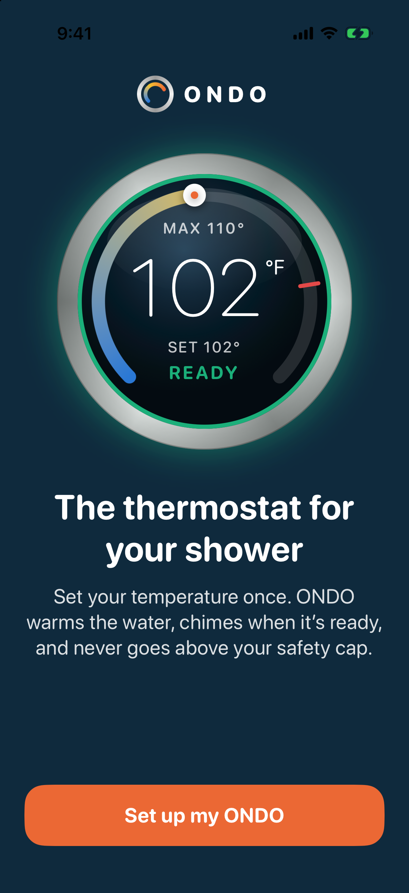
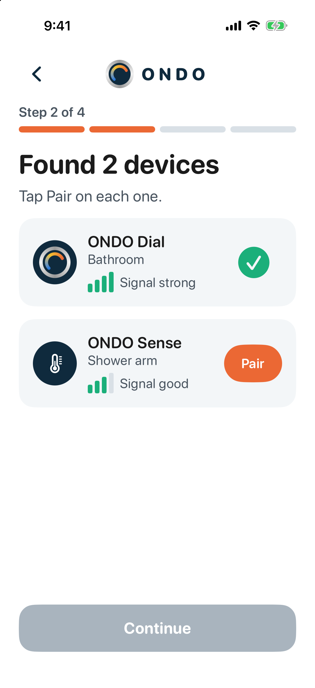
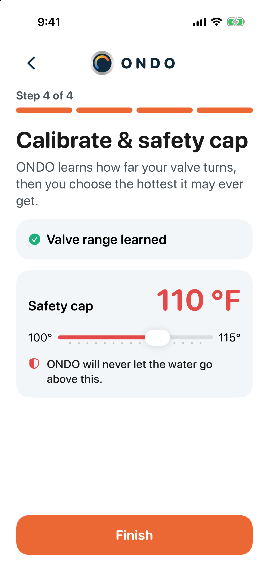
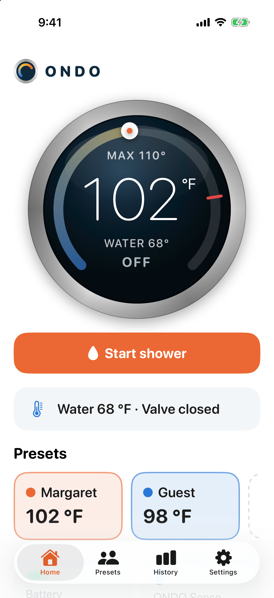
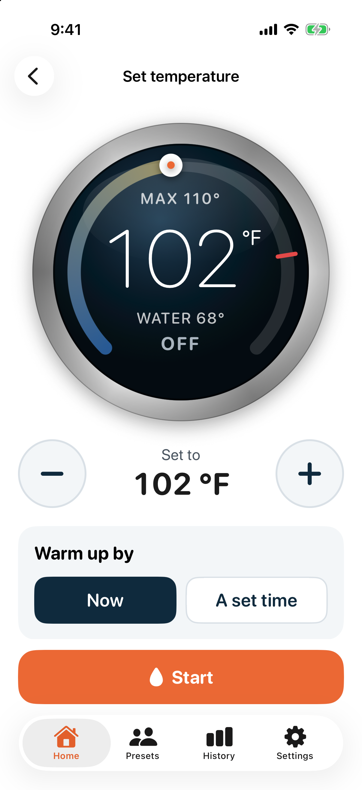
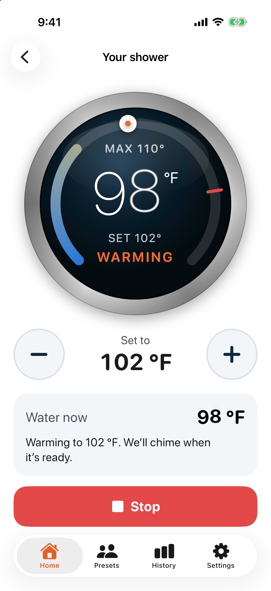
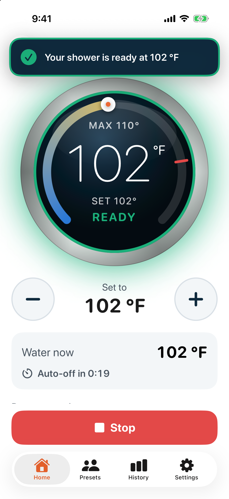
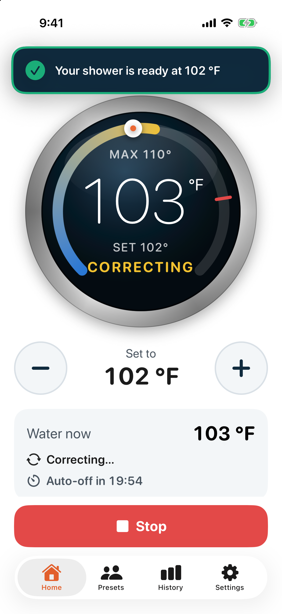

# ONDO: smart shower dial (mock app)

A clickable SwiftUI prototype of the companion app for **ONDO**, a motorized dial that replaces a single-handle shower handle and works like a thermostat. You set a temperature, ONDO turns the valve, chimes when the water is ready, holds ±1 °F and never goes above a safety cap.

> **Everything is mocked.** There is no Bluetooth, networking or backend. Pairing, the valve, the ONDO Sense sensor and the water temperature are all simulated in memory with timers (`Models/ShowerController.swift`).

## Build and run

Requirements: Xcode 15 or newer (iOS 17 SDK) and [XcodeGen](https://github.com/yonaskolb/XcodeGen).

```sh
brew install xcodegen
xcodegen generate            # creates ONDO.xcodeproj from project.yml
open ONDO.xcodeproj          # then run the "ONDO" scheme on an iPhone simulator
```

From the command line:

```sh
xcodebuild -project ONDO.xcodeproj -scheme ONDO \
  -destination 'platform=iOS Simulator,name=iPhone 17' build   # build
xcodebuild -project ONDO.xcodeproj -scheme ONDO \
  -destination 'platform=iOS Simulator,name=iPhone 17' test    # unit tests
```

If `xcodebuild` says it needs Xcode rather than the Command Line Tools, prefix the commands with
`DEVELOPER_DIR=/Applications/Xcode.app/Contents/Developer`.

## Demo tips

- **Hidden debug menu:** long-press the ONDO logo. It has "Simulate pairing failure", demo mode, toilet flush, skip to ready and reset demo.
- **Demo mode** (on by default) shortens the 20-minute auto-off to 20 seconds.
- **Simulate toilet flush** (on the shower screen) spikes the water +4 °F. The controller brings it back in about 3 s and the reading never exceeds the cap.
- **Jump straight to a screen** (used for the screenshots):
  `xcrun simctl launch booted com.ondo.mock -ondoScreen <name>`, where `<name>` is one of
  `welcome`, `install`, `searching`, `valve`, `calibrate`, `home`, `setpoint`, `warming`, `ready`, `flush`, `presets`, `history`, `settings`, or `tour` (an unattended warm-up → ready → flush run for screen recordings).

## Project layout

| Folder | Contents |
| --- | --- |
| `App/` | App entry, root view (ready banner + chime), launch options |
| `Models/` | `ShowerController` (simulation), models, mock history |
| `Components/` | `DialView` (hero dial), cards, logo, step indicator, chips |
| `Views/` | Onboarding & pairing, Home, set-point/shower session, Presets, History, Settings |
| `Theme/` | Colors from the pitch deck and button styles |
| `Tests/` | XCTest: cap enforcement, reaching READY, flush never exceeds cap, auto-off |
| `screenshots/` | Slide-ready screenshots and `demo.mov` |
| `scripts/make-icon.swift` | Renders the app icon |

## Screenshots

| Welcome | Devices found | Calibrate & cap | Home |
| --- | --- | --- | --- |
|  |  |  |  |

| Set-point | Warming | Ready | Flush correction |
| --- | --- | --- | --- |
|  |  |  |  |
